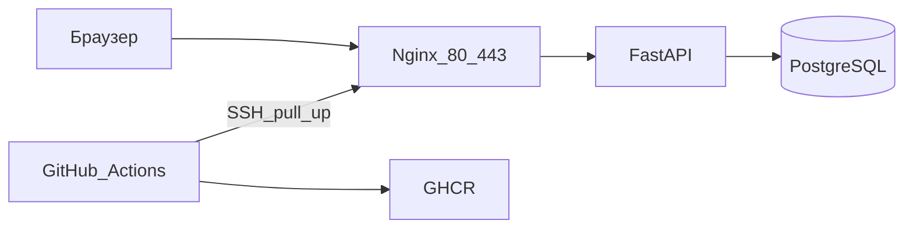

# docker-vps-deploy

Учебный проект: небольшой сайт уезжает на VPS с Debian 12 через Docker Compose. Репозиторий показывает цепочку, которую junior DevOps может собрать и пересказать: образ, база с данными на диске, обратный прокси, сертификат, секреты и pipeline.

Лицензия: MIT.

## Статус

Готово:

- фундамент: правила, хуки, навыки агента, схема и решения;
- приложение FastAPI и тесты pytest.

Запланировано, файлов ещё нет:

- Dockerfile;
- `docker-compose.yml`;
- конфиг Nginx и выпуск сертификата;
- workflow GitHub Actions.

Сайт на VPS ещё не открывается: нет образа и compose. Порядок работ — в `docs/layout.md`.

## Что умеет приложение

- `GET /health` — процесс жив, ответ в JSON.
- страница `/` — счётчик посещений в PostgreSQL. Обновление страницы увеличивает число.

Этого достаточно, чтобы после деплоя было что проверить. Бизнес-логики в проекте нет намеренно.

## Стек

| Часть | Выбор |
| --- | --- |
| Приложение | Python, FastAPI |
| База | PostgreSQL 16, данные в volume |
| Прокси и TLS | Nginx, сертификат Let's Encrypt через Certbot |
| Запуск на сервере | Docker Compose |
| Проверки | Ruff и pytest в GitHub Actions |
| Реестр | GitHub Container Registry |
| Сервер | Один VPS, Debian 12 |
| Секреты | `.env` на сервере, GitHub Secrets для SSH |

Почему выбран Certbot, а не связка nginx-proxy и acme-companion: `docs/decisions/0002-https.md`.

## Архитектура



Браузер попадает только на Nginx. Nginx проксирует запрос в FastAPI по внутренней сети Compose. FastAPI читает и увеличивает счётчик в PostgreSQL. Наружу порты приложения и базы не публикуются.

GitHub Actions на push в `main` гоняет линтер и тесты, публикует образ в GHCR и по SSH выполняет на сервере:

```bash
docker compose pull && docker compose up -d
```

Подробная схема: `docs/architecture.md`.

## Структура

```text
app/                  FastAPI: /health и счётчик
tests/                pytest без живой базы
nginx/                конфиг прокси, пока пусто
deploy/               команда обновления на VPS, пока пусто
.github/workflows/    pipeline, пока пусто
docs/                 архитектура, решения, ответы, проверка
.cursor/rules/        правила для агента по темам
.cursor/hooks/        запрет локального Docker и секретов в git
.cursor/skills/       как объяснять шаг и как проверять сервер
.env.example          имена переменных, без настоящих паролей
```

Карта с пометкой «готово / запланировано»: `docs/layout.md`.

## Секреты

В git есть только `.env.example`. Настоящий `.env` создаётся вручную на VPS и в репозиторий не кладётся. Туда входят пароль базы, домен, почта для Let's Encrypt и имя образа.

Ключ, которым Actions заходит на VPS, хранится в GitHub Secrets: `VPS_HOST`, `VPS_USER`, `VPS_SSH_KEY`. В логи ключ не печатается. Пароль базы в Actions не передаётся: он уже лежит на сервере.

## Как запустить

Docker на компьютере, где пишется код, недоступен. Локального запуска в этом проекте нет. Рабочий запуск — на VPS, после того как появятся compose-файл и образ.

Целевые шаги, когда код будет готов:

1. На VPS установить Docker Engine и плагин Compose. Открыть порты 22, 80, 443.
2. Домен направить A-записью на IP сервера.
3. Склонировать репозиторий на сервер. Рядом с `docker-compose.yml` скопировать `.env.example` в `.env` и подставить свои значения.
4. Первый выпуск сертификата сделать по `docs/decisions/0002-https.md`: сначала только порт 80, затем 443.
5. Дальше сервер обновляется из Actions. Вручную та же команда:

   ```bash
   docker compose pull && docker compose up -d
   ```

## Как откатить

Образ каждого коммита тегируется SHA и остаётся в GHCR.

1. Выбрать SHA предыдущего успешного деплоя.
2. На сервере в `.env` заменить `APP_IMAGE` на этот тег.
3. Выполнить `docker compose pull && docker compose up -d`.
4. Открыть `/health`.

Volume базы при откате не удалять. `docker compose down -v` сотрёт счётчик. Для отката эта команда не используется.

Если pipeline упал до SSH, на сервере остаётся прежний контейнер. Откатывать нечего.

## Как проверить

Приложение проверяется без Docker и без базы:

```bash
pip install -e ".[dev]"
ruff check app tests
pytest
```

`/health` в тесте вызывается без `DATABASE_URL`. Счётчик в тесте получает число из подмены, а не из PostgreSQL.

Дополнительно в репозитории:

- `.env` не закоммичен;
- в `.env.example` стоят `change-me` и `example.com`;
- `docs/layout.md` не обещает файлов, которых нет.

После деплоя чеклист на сервере лежит в `docs/runbook.md`: `docker compose ps`, `curl` на `/health`, два запроса к счётчику, рестарт базы без потери числа.

## Документы

| Файл | Зачем читать |
| --- | --- |
| `docs/architecture.md` | Схема и границы сервисов |
| `docs/decisions/` | Почему стек, HTTPS и pipeline именно такие |
| `docs/interview.md` | Короткие формулировки для собеседования |
| `docs/runbook.md` | Команды на VPS |
| `AGENTS.md` | Как агенту вести этот репозиторий |

## Агент в репозитории

`.cursor/rules/` держит ограничения короткими: без локального Docker, без секретов в git, документы без эмодзи.

`.cursor/hooks/guard-shell.py` останавливает команду Docker на рабочей станции, обращение к живому `.env` и force push.

`.cursor/hooks/guard-writes.py` не даёт записать `.env`, ключ или сертификат в дерево репозитория.

Навыки в `.cursor/skills/` задают форму объяснения и порядок проверки сервера.
