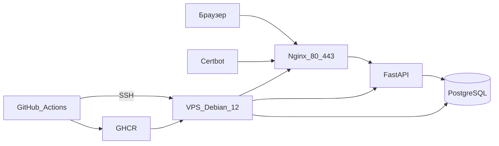

# Архитектура

Один VPS с Debian 12. На нём Docker Compose поднимает три долгоживущих сервиса. Сборку образа делает GitHub Actions, сервер только скачивает уже готовый образ.



Текстом, если схему неудобно смотреть:

```text
Браузер
  -> Nginx :443 (сертификат Let's Encrypt)
    -> FastAPI (сеть Compose, порт наружу не открыт)
      -> PostgreSQL (volume, наружу не открыт)

GitHub Actions
  -> проверки и сборка
  -> образ в GHCR
  -> SSH на VPS: sh deploy/update.sh
```

## Кто за что отвечает

| Часть | Обязанность |
| --- | --- |
| Nginx | Принимает 80 и 443. Отдаёт сайт и файл проверки Certbot. В приложение ходит по внутренней сети Compose. |
| FastAPI | `GET /health` отвечает, жив ли процесс. Страница счётчика читает и увеличивает число в PostgreSQL. |
| PostgreSQL | Хранит счётчик. Данные лежат в volume: пересоздание контейнера базу не стирает. |
| Certbot | Доказывает Let's Encrypt, что домен наш, и кладёт сертификат в общий volume. |
| GitHub Actions | Не пускает в реестр код, который не прошёл Ruff и pytest. На сервер попадает тег образа, а не папка с исходниками. |
| `.env` на VPS | Пароль базы, домен, почта для сертификата, имя образа. В git этого файла нет. |

## Сеть

С хоста открыты только 80 и 443 на Nginx. Приложение и база доступны по именам `app` и `postgres` внутри сети Compose. Имя `postgres` в `DATABASE_URL` — это имя сервиса, не адрес VPS.

## Что переживёт перезапуск

- Код приложения живёт в образе. Новый деплой заменяет контейнер `app`.
- Счётчик живёт в volume Postgres. `docker compose up -d` volume не удаляет.
- Сертификат живёт в отдельном volume. Пересборка Nginx его не стирает.
